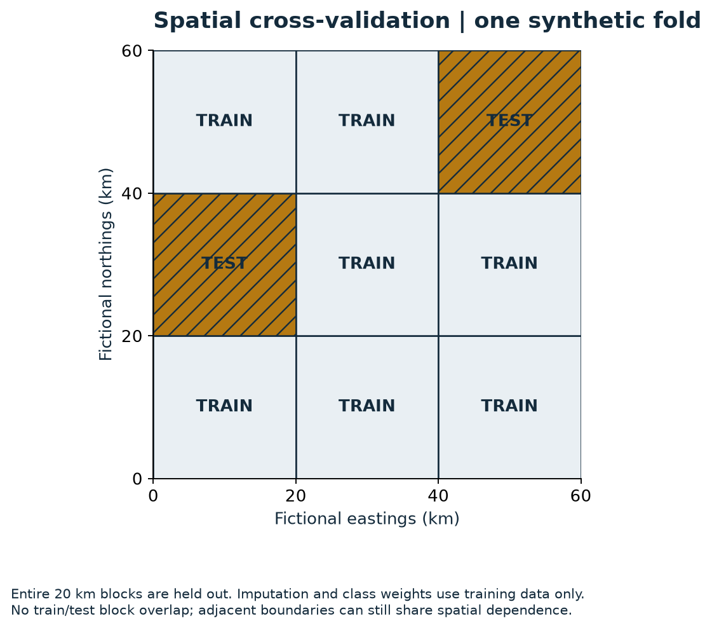
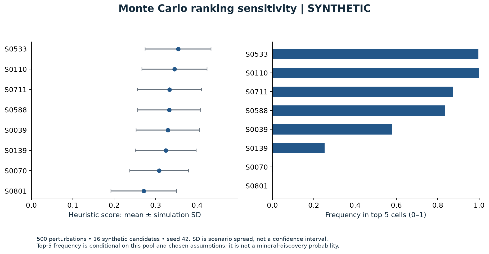

# Methodology

## Scope and scientific question

The project asks whether regional geological evidence can help prioritise follow-up research beyond a fault-distance baseline. Regional prospectivity, legal availability, discovery and economic viability are separate questions. Scores do not establish subsurface resources, exploration rights or permission for field activity.

## Implemented components

| Stage | Actual implementation | Contribution and boundary |
|---|---|---|
| Cadastre acquisition | `scripts/00_download_tukes_map_files.py` | Parses Tukes ATOM links, downloads and extracts files; archive traversal guard added. Live service and rights need rechecking. |
| Grids and coordinate handling | `01_make_aoi_grid.py`, `04b_refine_aoi_to_clgb.py` | EPSG:3067 metric grids, clipped edges, WGS84 conversion; missing bedrock CRS now fails instead of being guessed. Manual CLGB envelope is approximate geography. |
| Overlay / status | `02_mask_taken_areas.py`, `02c_classify_tukes_status.py`, `04c_build_restriction_masks.py` | Polygon union/intersection and overlap thresholds. Missing masks are a coverage gap, not proof land is available. |
| Regional grouping | `04_cluster_open_cells.py` | Spatial cell clustering; no release of private cluster selections. |
| Geological acquisition | `05_load_gtk_layers.py` | Paged ArcGIS queries with declared source/output CRS. Dataset licences must be checked individually. |
| Features | `06_build_minimal_feature_stack.py` | Nearest structure distance, number of line intersections within 5 km, distance to bedrock polygon boundaries. Boundaries are proxies, not verified mineralised contacts. |
| Geophysics | `06c_process_magnetics.py`, `06d_process_gravity.py` | Rejects display-only magnetics; computes horizontal Bouguer gradient and samples cell centroids. |
| Till chemistry | `19_build_interim_till_features_au_as_sb.py`, `11c_till_shift_ablation.py` | Half-minimum-positive substitution, Au/As/Sb CLR/log features and provisional up-ice scenarios. Sparse survey and detection-limit assumptions matter. |
| Labels / background | `07_build_clgb_positive_labels.py`, `08_build_unlabelled_background.py` | Filters published deposit categories; positives inside cells; excludes background within 5 km of positives. Remaining cells are unlabelled. |
| Spatial blocks | `09_make_spatial_blocks.py` | 20 km lattice from centroid coordinates; entire blocks assigned to folds. |
| Baselines | `10_distance_to_fault_baseline.py` | Inverse fault distance and seeded uniform noise. Distance to the label-defining deposits is a circular diagnostic, excluded from honest comparisons. |
| ML and ablation | `11_train_baseline_xgboost_or_pu.py`, `_evaluation.py`, `22_feature_ablation_audit.py` | Weighted XGBoost binary classification of positives versus unlabelled background, not a formal PU-risk estimator. |
| Evaluation | `11b_topk_capture_metrics.py` | OOF ROC-AUC and cell-count capture at top 1/5/10%; explicit complete-coverage check and tie bounds. |
| Sensitivity | `run_monte_carlo_top10.py` | Perturbed weights, decay scales and penalties; weighted geometric evidence combination; conditional rank frequencies. |
| Public demonstration | `demo.py`, `make_figures.py` | Synthetic fixture exercises retained core functions, with known limitations and no real targets. |

All numbered entries are in [scripts](scripts). Original target maps, v2 experiments and acquisition diagnostics are preserved in the private backup and inventoried in [the capability audit](docs/CAPABILITY_AUDIT.md).

## Geometry and physical units

EPSG:3067 is ETRS89 / TM35FIN. Distances and areas require a projected metric CRS; the release tests a forward/inverse transformation. The 2 km historical grid has 3,798 cells before evaluation filtering. The 3,649-row evaluation is a different denominator. The context map is simplified Natural Earth geography, not a geological boundary.

The historical gravity report used a numeric 2.5 km Bouguer grid, with a WGS84 transverse-Mercator source definition (central meridian 21°E, false easting 1,500,000 m). The code nearest-fills missing grid values for differentiation, computes `sqrt((dB/dx)^2 + (dB/dy)^2) * 1000` in mGal/km, then restores missing source positions and interpolates to centroids. Missing-edge artefacts and regional smoothing remain limitations. A 2 km output grid cannot create resolution absent from a 2.5 km source.

The historical ECW magnetic file was a rendered image, unreadable by that GDAL build. It was not used as numeric magnetic intensity. The later v2 numeric-magnetics code exists in the private history, but its outputs/inputs are absent from the committed snapshot and its claims are not validated here.

## Labels, imbalance and validation

Known deposits define positive cells, while remaining eligible cells form unlabelled background. This is subject to survey/selection bias, cell-boundary effects and undiscovered positives. The exclusion buffer uses all known labels, including eventual held-out positives, so the evaluation population is conditioned on those labels. It should not be described as unbiased prospective deployment.

`GroupKFold` holds out entire 20 km blocks, up to five folds, without shuffling. The block origin and arrangement matter; neighbouring train/test boundaries remain adjacent. No spatial buffer between fold boundaries or block-size sensitivity has been validated on the real data.

The corrected release fits medians and negative/positive class weights **inside each training fold**. All-missing training columns use zero, explicitly. It refuses folds with only one training class, duplicate cell IDs and invalid values rather than silently shrinking the evaluation denominator. A final all-labelled model is used only for extra-cell scoring. Its training-set permutation importance is a resubstitution diagnostic, not held-out importance.

Historical XGBoost settings are preserved: 200 trees, depth 3, learning rate 0.08, row/column subsampling 0.9, seed 42, two worker threads. No hyperparameters were tuned to improve the published result during release preparation. Repeatability is assessed within the locked environment; bit-identical results across all operating systems are not promised.

## Metrics and decision rules

ROC-AUC measures ranking over all positive/background pairs. Top-k capture is `positives among the ceil(k% × n) highest-ranked cells / all evaluated positives`. It is cell-count based, not strictly area-weighted when cells are clipped. Stable input order breaks score ties in current code; min/max capture over the boundary tie is also reported. Historic tie handling was NumPy's default unstable ordering, so tied baselines deserve sensitivity analysis.

The original Step 2 gate required strictly better top-5% capture **and** AUC than fault distance. The later v2 gate used `>=` comparisons and a different score/population; its “PASS” wording is not interchangeable. The 80% capture benchmark was not achieved. This release does not convert any gate into a claim of discovery.

## Monte Carlo sensitivity

The retained engine samples group weights from Dirichlet distributions; clipped-normal distance-decay scales; and assumptions about evidence thresholds, missingness and penalties. It combines evidence scores through a weighted geometric mean and records rank frequencies and mean/SD. These are assumption-driven sensitivity results, conditional on the candidate pool. They do not infer an empirical probability of a deposit.

The original engine also contains a prior/likelihood-ratio odds transform. Its prior and likelihood ratios were not empirically calibrated; that transform is not displayed as a probability in the public demonstration. Missing columns can be default-filled, and partial missingness remains a modelling limitation. The demo uses 500 iterations, seed 42 and 16 synthetic candidates. Simulation SD is scenario spread, not a confidence interval. The historical 20,000-iteration/v2 claims are not reproduced with real cells.

## Demonstration boundary

The synthetic fixture has 900 equal-size cells in a fictional metric plane, nine constructed positives, invented faults/contacts and a synthetic gravity-like feature. Labels are sampled from a deliberately specified feature-related propensity; predictive performance is therefore illustrative. The 20 km grouping and all train/test transformations are inspectable in `data/example/folds.json`. A broad Finland map is the only genuine geographic figure. No original targets are embedded in figures, fixtures or lookup tables.
