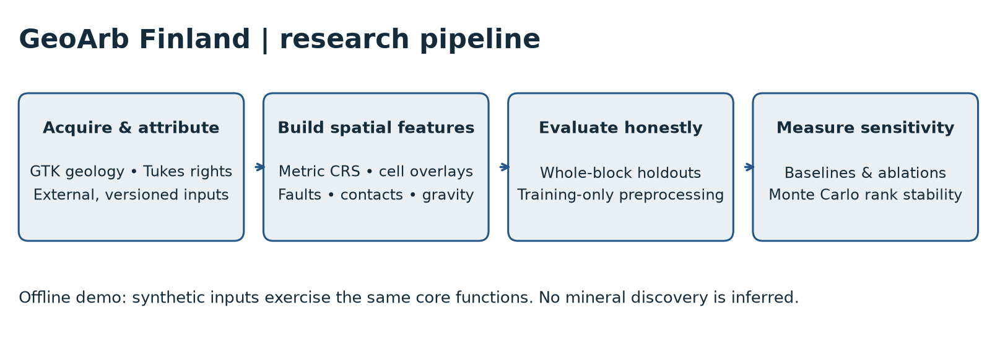
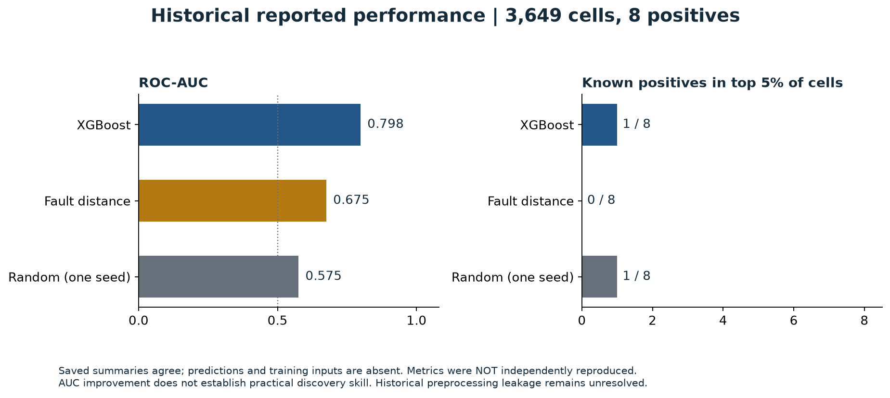

# GeoArb Finland

**Geospatial machine learning for gold-prospectivity research, with spatial validation and explicit uncertainty.**

An independently directed, AI-assisted research-engineering project by **MoheetBrain**, BSc Artificial Intelligence student at the **University of Westminster**. It combines Python GIS, geological feature engineering, XGBoost, baseline comparisons and Monte Carlo sensitivity analysis. The release includes a working **offline synthetic demonstration**, reviewed historical aggregate results and tests for scientific software failure modes.

**Release candidate — private, awaiting publication and licence approval.** No unpublished exploration-target locations are included. This project has not discovered a mineral deposit or established commercial viability.



## What was investigated?

Can geological and geophysical features improve regional prioritisation beyond simply ranking cells by distance to a fault? The Central Lapland Greenstone Belt in northern Finland was chosen as an established orogenic-gold setting with accessible geological services. The question concerns statistical screening, not proving that gold is present.

The original pipeline builds metric grids in EPSG:3067, overlays mining-register and restriction polygons, computes structure/contact distances and geophysical features, and compares XGBoost with geological and random baselines. Unlabelled background cells are not known barren ground. Whole spatial blocks are withheld during cross-validation; this reduces one source of leakage but does not guarantee independence.

## What the evidence says

| Historical 2 km evaluation | XGBoost | Fault-distance baseline |
|---|---:|---:|
| ROC-AUC | 0.798 | 0.675 |
| Positives captured in top 5% of cells | 1 / 8 | 0 / 8 |
| Positives captured in top 10% of cells | 1 / 8 | 2 / 8 |

These are **inherited, internally consistent aggregate reports**, not independently reproduced metrics. The 3,649 evaluation rows, original feature tables and OOF predictions were not committed. The release audit found full-dataset imputation and class-weight calculation before cross-validation; the current code corrects these for future runs, but the historical numbers have not been recalculated. A single seeded random baseline also captured 1 / 8 at top 5%. An earlier structure-only model failed its capture gate despite AUC around 0.715.



No working geological graph neural network was found. A TerraMind token-extraction prototype existed, but a separate purported XGBoost-fusion script generated a contrived score; it is excluded. Monte Carlo outputs measure sensitivity to assumed weights and decay scales, **not calibrated discovery probabilities**.

## Run the offline demonstration

Python 3.12; no accounts, API keys or data downloads required after dependency installation. On macOS, first install the OpenMP runtime with `brew install libomp`. Linux commonly provides `libgomp1` through its package manager.

```bash
python3.12 -m venv .venv
source .venv/bin/activate
python -m pip install -r requirements-lock.txt
python -m pytest -q
python scripts/demo.py --output runs/demo
python scripts/check_release.py
```

The deterministic demo generates invented geological layers and labels in a fictional metric plane. It runs original grid, overlay and feature functions; corrected grouped XGBoost; baselines and ablations; and the retained Monte Carlo engine. Its metrics are **software demonstrations, not evidence of performance in Finland**. See [reproduction commands and boundaries](REPRODUCIBILITY.md).

## Explore the project

- [Methods and implemented pipeline](METHODOLOGY.md)
- [Results, chronology and limitations](RESULTS_AND_LIMITATIONS.md)
- [Scientific audit and corrections](docs/SCIENTIFIC_AUDIT.md)
- [Data sources, licensing and attribution](DATA_SOURCES_AND_LICENSES.md)
- [Historical aggregates](data/historical/README.md) and [synthetic example outputs](data/example/README.md)
- [Publication gate](PUBLICATION_GATE.md), [security review](docs/SECURITY_AUDIT.md) and [contributing](CONTRIBUTING.md)

## Engineering demonstrated

Python and GeoPandas/Shapely geometry operations; CRS transformations with PyProj; raster-gradient processing; missing-data provenance; spatially grouped ML evaluation; feature ablations; deterministic numerical simulation; regression testing; dependency locking; and evidence-based technical documentation. Real-data ingestion and historical experiments are distinguishable from the small reproducible demonstration.

I directed the research objectives, methodology and engineering work; AI coding agents assisted implementation and research. The release audit and software tests provide bounded verification, not independent geological field validation. The project is not university-endorsed or peer reviewed.

**Licensing:** MIT is proposed for project-owned code in [LICENSE.proposed](LICENSE.proposed), pending owner approval. Third-party data has separate terms; raw geological data and proprietary imagery are not redistributed. Do not make the original private repository public: use the prepared clean-history candidate only after approval.
